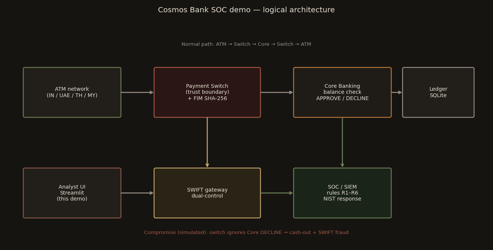

# Cosmos Bank SOC Demo

Streamlit SOC console based on the **2018 Cosmos Co-operative Bank (Pune)** incident: payment-switch compromise, ATM cash-out, and unauthorised SWIFT. Ledger and alerts stay in local SQLite.

## GitHub

https://github.com/nimitajestin/Cybersec-Cosmos-Bank-Attack

## How to execute the project

**Requirements:** Python 3.10 or newer (tested on Python 3.11, Windows).

```bat
cd Cybersec-Cosmos-Bank-Attack
python -m venv venv
venv\Scripts\activate
pip install -r requirements.txt
streamlit run Home.py
```

The app opens at **http://127.0.0.1:8501**. A local SQLite file `cosmos_soc.db` is created on first run.

If `venv` is already created:

```bat
cd Cybersec-Cosmos-Bank-Attack
venv\Scripts\activate
streamlit run Home.py
```

Use the left sidebar. Suggested order:

1. Normal Operation — small withdrawal, all hops approve.
2. Switch Compromise — toggle compromise, send an over-limit withdrawal (core declines, switch still approves). Check FIM hashes.
3. ATM Cash-Out — 100–300 withdrawals.
4. SOC Dashboard — alerts R1–R6, isolate switch, lock SWIFT, enable controls, replay cash-out (should block).
5. SWIFT Fraud, Investigation, Frameworks.

## Architecture



ATM → payment switch → core banking. If the switch stops copying the core decision, ATMs can dispense against a **DECLINED** authorisation.

## Detection rules

| Rule | Severity | Trigger |
|---|---|---|
| R1 | CRITICAL | Withdrawal above available balance |
| R2 | HIGH | >10 txns per card per minute |
| R3 | CRITICAL | Same card in 2+ countries in 30 min |
| R4 | CRITICAL | Switch decision ≠ core decision |
| R5 | HIGH | ATM velocity ≥ 3× quiet-hour baseline |
| R6 | HIGH | SWIFT transfer ≥ ₹1 crore |

NIST SP 800-61 stages are ticked from the sidebar as you run the demo. Kill Chain / MITRE notes are on the Frameworks page (unknown stages are marked `?` on purpose).

## Screenshots

| | |
|---|---|
| [Normal withdrawal](screenshots/1_normal.png) | [Switch mismatch](screenshots/2_compromise_mismatch.png) |
| [Cash-out](screenshots/3_cashout_dashboard.png) | [SOC alerts](screenshots/4_alerts_timeline.png) |
| [Containment](screenshots/5_nist_containment.png) | [Defense blocked](screenshots/6_defense_blocked.png) |
